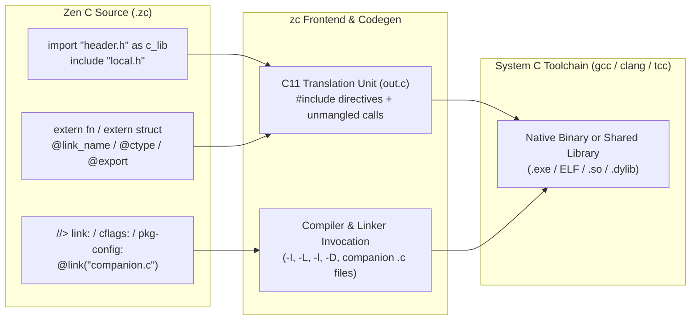

# Using C Libraries

Most modern systems languages treat C interoperability as a **Foreign Function Interface (FFI)**—a boundary across which data structures must be converted, strings copied or marshaled, headers translated by external code-generation tools (like `bindgen` or `cgo`), and build scripts configured in a separate language.

Zen C takes a fundamentally different approach: **C is not foreign to Zen C**. Because the Zen C compiler (`zc`) transpiles directly to standard C11 and invokes your system C compiler (`gcc`, `clang`, or `tcc`), Zen C shares the **exact same Application Binary Interface (ABI)**, calling conventions, struct memory layout, and preprocessor ecosystem as C.

Calling a C function from Zen C—or exporting a Zen C function to C—has **zero runtime overhead**:

- **No marshaling or wrapper glue**: A Zen C pointer (`T*`), struct, or primitive integer is passed in the exact hardware registers specified by the platform's C ABI.
- **Direct header consumption**: You can import standard or third-party `.h` files directly into a Zen C namespace (`import "zlib.h" as zlib;`) or include local project headers (`include "sensor_hal.h"`) without running an external binding generator first.
- **Self-contained build directives**: Library flags (`//> link: -lm`), include search paths (`//> include: ./vendor`), `pkg-config` queries (`//> pkg-config: sdl2`), and companion `.c` source files (`@link("crc16.c")`) can be declared directly inside your `.zc` source file so `zc run` and `zc build` work out of the box.

---

## Choosing the Right Interop Mechanism

Zen C provides several complementary ways to interface with C code depending on whether you want quick exploratory access to a C header, strict type-checked signatures, or a clean multi-platform build setup:

| Mechanism | Syntax | Best Used When... |
| :--- | :--- | :--- |
| **Namespaced Header Import** | `import "math.h" as c_math;` | You want to call functions or reference types from a C header under a clean module prefix (`c_math::hypot(3.0, 4.0)`) without polluting the global namespace. |
| **Local Header Include** | `include "sensor_hal.h"` | You have a local C header whose `#define` integer constants, `typedef struct` definitions, and function prototypes should be automatically scanned into Zen C's symbol table. |
| **System Header Include** | `include <stdio.h>` | You need standard C preprocessor `#include <...>` emission alongside explicit `extern fn` declarations or `zenc.json` whitelisting. |
| **Explicit FFI Declarations** | `extern fn`, `extern struct`, `extern let` | You want full Zen C type checking on arguments and return types—even without including a `.h` file—or you want to hide C implementation details behind an opaque pointer (`MockDb*`). |
| **FFI Attributes** | `@link_name`, `@ctype`, `@crepr`, `@export` | You need to rename a colliding C symbol, preserve `const` qualifiers on C pointer parameters, or export a Zen C function to C callers in a shared library (`zc build -shared`). |
| **Build Directives** | `//> link:`, `//> pkg-config:`, `@link("file.c")` | You want `zc build` and `zc run` to automatically pass `-I`, `-L`, `-l`, `-D`, or `-framework` flags and compile companion `.c` files on Linux, macOS, and Windows. |

---

## What You Will Learn in This Chapter

1. **[12.1 C Header Imports vs Includes](ch12-01-c-headers.md)**: Understand the difference between `import "header.h" as alias`, `include <header.h>`, and `include "local.h"`, how Zen C's automatic header scanner registers C symbols, and how to whitelist C functions and types in `zenc.json`.
2. **[12.2 Explicit FFI Declarations](ch12-02-ffi-declarations.md)**: Declare typed `extern fn` signatures, opaque `extern struct` and `extern union` handles, external C globals (`extern let`), symbol aliases (`@link_name`), shared-library exports (`@export`), and inline `raw { ... }` C blocks.
3. **[12.3 C Types, Strings, and Variadics](ch12-03-c-types-variadics.md)**: Master portable C ABI types (`c_int`, `c_long`, `usize`, `void*`) across LP64 (Linux/macOS) and LLP64 (Windows) platforms, pass strings safely with `@ctype("const char*")`, and both call and author C variadic functions (`...`, `va_list`, `va_start`, `va_arg`, `va_end`).
4. **[12.4 Linking and Build Directives](ch12-04-linking-directives.md)**: Configure linker libraries, compiler flags, include/library paths, macOS frameworks, preprocessor defines, `pkg-config` packages, OS-conditional directives (`//> linux:`, `//> macos:`, `//> windows:`), and companion `.c` files (`@link`).
5. **[12.5 Hands-on Example: Raylib Graphics Window](ch12-05-raylib-example.md)**: Combine everything in this chapter to build a cross-platform graphics and physics loop using Raylib's C API, automatic `defer` window cleanup, and value-passed C structs (`Vector2`, `Color`).
