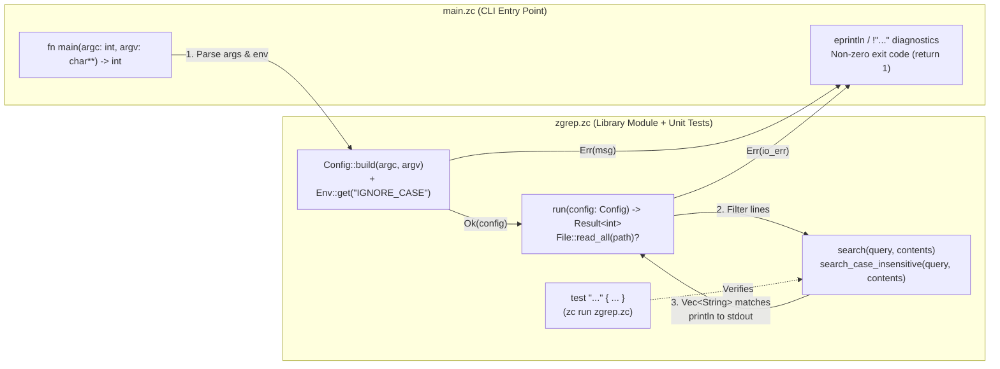

# An I/O Project: Building `zgrep`

Over the first twelve chapters, we have toured the core foundations of Zen C—ownership, pointers, structs, enums, modules, dynamic collections (`Vec<T>`, `String`), recoverable error handling (`Result<T>`, `Option<T>`, `?`), generics, automated `test` blocks, and zero-overhead C interoperability.

To cement these concepts and see how they fit together in a real-world systems application, we will spend this chapter building **`zgrep`** (Zen C **g**lobally search a **r**egular **e**xpression and **p**rint): a fast, self-contained command-line search tool modeled after the classic Unix `grep` utility.

In its simplest form, `zgrep` accepts a search query string and a file path as command-line arguments, reads the target file from disk, scans every line for the query string, and prints matching lines to standard output:

```bash
$ zc build main.zc -o zgrep
$ ./zgrep frog poem.txt
How public, like a frog
```

Along the way, our implementation of `zgrep` will bring together features from across Parts I and II of this book:

| Concept | Where You Learned It | How `zgrep` Uses It |
| :--- | :--- | :--- |
| **Modules & Encapsulation** | [Chapter 7](ch07-00-modules.md) | Splitting the thin CLI entry point (`main.zc`) from the testable core library module (`zgrep.zc`). |
| **Collections (`String` & `Vec<T>`)** | [Chapter 8](ch08-00-common-collections.md) | Reading file contents into a heap-allocated `String`, splitting lines into `Vec<String>`, and normalizing case with `.to_lowercase()`. |
| **Error Handling (`Result<T>` & `?`)** | [Chapter 9](ch09-00-error-handling.md) | Returning `Result<Config>` when parsing arguments and propagating file I/O errors with `File::read_all(path)?`. |
| **RAII Cleanup (`Drop` & `defer`)** | [Chapter 4](ch04-00-ownership-pointers-cleanup.md) | Automatically closing OS file handles and freeing temporary line buffers on every return path without manual `free()` calls. |
| **In-Module Unit Tests (`test`)** | [Chapter 11](ch11-00-testing.md) | Writing test-driven `test "..."` blocks directly inside `zgrep.zc` and running them via `zc run zgrep.zc`. |
| **C ABI Entry Point & I/O Streams** | [Chapter 3](ch03-04-printing-and-interpolation.md) & [Chapter 12](ch12-00-using-c-libraries.md) | Accepting `fn main(argc: int, argv: char**) -> int`, reading environment variables via `std/env.zc`, and separating `stdout` (`println`) from `stderr` (`eprintln` / `!"..."`). |

---

## Architecture of `zgrep`

By the end of this chapter, our project will follow the idiomatic Zen C **dual-target CLI architecture**: a tiny `main.zc` binary entry point paired with a self-testing `zgrep.zc` library module.



Separating `main.zc` from `zgrep.zc` gives us two major benefits:
1. **Clean Separation of Concerns**: `main.zc` handles only process-level concerns—passing `argc`/`argv`, formatting user-facing errors to `stderr`, and returning an OS exit code (`0` or `1`). All actual domain logic lives in `zgrep.zc`.
2. **Zero-Friction Testing**: Because `zgrep.zc` has no `fn main()`, running `zc run zgrep.zc` automatically synthesizes a test runner and executes all embedded `test "..."` blocks, while `zc build main.zc -o zgrep` compiles the full command-line binary.

---

## Chapter Roadmap

We will build `zgrep` step by step across five sections:

1. **[13.1 Accepting Command Line Arguments](ch13-01-cli-arguments.md)**: Inspecting `argc` and `argv` in `fn main(argc: int, argv: char**) -> int`, extracting the search query and file path, and building CLI binaries with `zc build`.
2. **[13.2 Reading a File](ch13-02-reading-file.md)**: Creating a sample `poem.txt` file and reading its contents into memory using `std/fs.zc` (`File::read_all`, `File::read_lines`, and RAII `File` handles).
3. **[13.3 Refactoring to Improve Modularity and Error Handling](ch13-03-refactoring.md)**: Extracting a `Config` struct, replacing panics with `Result<Config>` and the `?` operator, splitting `zgrep.zc` from `main.zc`, and implementing `search()` using Test-Driven Development (TDD).
4. **[13.4 Working with Environment Variables](ch13-04-env-variables.md)**: Using `std/env.zc` (`Env::get`, `Env::get_dup`, `Env::set`, `Env::unset`) to add case-insensitive search (`search_case_insensitive`) controlled by the `IGNORE_CASE` environment variable.
5. **[13.5 Writing Error Messages to Standard Error](ch13-05-stderr.md)**: Routing diagnostic messages to `stderr` (`eprintln` and `!"..."`) instead of `stdout` (`println`) so shell output redirection (`> output.txt`) and pipelines work as users expect.
