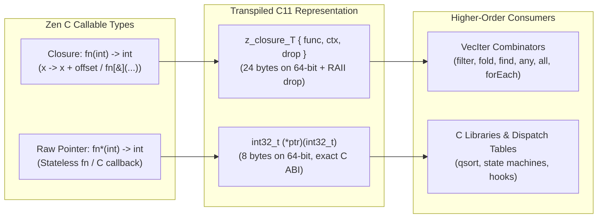

# Chapter 14: Functional Features: Closures and Iterators

Functional programming—passing functions as values, capturing lexical state in anonymous closures, and transforming sequences of data through declarative iterator pipelines—is often associated with garbage-collected languages. Historically, systems programmers writing C had to choose between expressive higher-order abstractions and raw hardware predictability.

Zen C bridges this divide by offering **three distinct callable and iterable abstractions**, each with a transparent, predictable C11 compilation model:

1. **Lambdas and Closures (`fn(Args) -> Ret`)**: Anonymous functions that can capture variables from their enclosing scope either **by value** (default / `[=]`) or **by reference** (`[&]`), represented at runtime as a fat closure struct (`z_closure_T { void* func; void* ctx; void (*drop)(void*); }`) with automatic RAII context cleanup.
2. **Raw Function Pointers (`fn*(Args) -> Ret`)**: Zero-overhead, stateless C function pointers (`Ret (*)(Args)`) that require no context allocation and pass directly across the C ABI to system APIs like `qsort`, `signal`, or event-loop callbacks.
3. **Iterators (`Iterator<T>` and `VecIter<T>`)**: Stateful cursor structs that power both `for item in collection` loops (via static compile-time monomorphization) and functional combinators like `.filter(...)`, `.fold(...)`, `.find(...)`, `.any(...)`, and `.all(...)`.

---

## Choosing Between `fn(...)` Closures and `fn*(...)` Pointers

| Feature | Closure (`fn(T) -> R`) | Raw Function Pointer (`fn*(T) -> R`) |
| :--- | :--- | :--- |
| **Can capture local variables?** | **Yes** (`[=]` by value, `[&]` by reference) | **No** (stateless top-level `fn` only) |
| **C11 representation** | `z_closure_T { func, ctx, drop }` (24 bytes) | `R (*)(T)` (8 bytes on 64-bit) |
| **Heap allocation** | Context struct allocated when capturing state; freed automatically via `.drop` | **Zero** heap allocation |
| **C FFI compatibility** | Zen C higher-order functions & `VecIter<T>` | **100% C ABI compatible** (`qsort`, `pthread`, C structs) |

---

## Chapter Roadmap

In this chapter, we will explore Zen C's functional tools and their underlying C11 code generation:

1. **[14.1 Lambdas and Closure Capture](ch14-01-lambdas.md)**: Authoring anonymous functions with concise arrow syntax (`x -> x * 2`) and explicit block syntax (`fn(x: int) -> int { ... }`), capturing environment state by value (`[=]`) vs. by reference (`[&]`), and writing higher-order functions that accept `fn(...)` closures.
2. **[14.2 Raw Function Pointers (`fn*`)](ch14-02-fn-pointers.md)**: Declaring, returning, and storing stateless C function pointers (`fn*`) and pointers-to-function-pointers (`fn**`), building struct dispatch tables, and passing Zen C comparators directly to C's `qsort`.
3. **[14.3 Processing Items with Iterators](ch14-03-iterators.md)**: Understanding Zen C's `iterator()` / `next()` protocol, chaining `VecIter<T>` combinators (`filter`, `fold`, `find`, `any`, `all`, `forEach`), choosing between value (`VecIter<T>`) and reference (`VecIterRef<T>`) iteration, and implementing your own custom iterator structs.
4. **[14.4 Comparing Performance: Loops vs Iterators](ch14-04-performance.md)**: Inspecting the exact C11 loops emitted for indexed loops, `for ... in` iterators, and closure combinators, and understanding how backend C optimizers (`-O2` / `-O3`) inline and auto-vectorize them.
