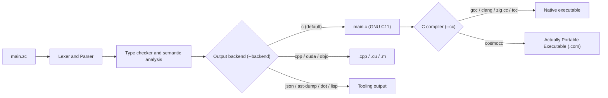

# The `zc` Toolchain and Compiler Backends

Every chapter so far has used `zc run` or `zc build` as a black box: you hand it a `.zc` file and get back a running program. In this chapter we open the box.

Zen C is a **transpiler**. `zc` parses and type-checks your Zen C source, then emits a readable GNU C11 file and hands that file to an ordinary C compiler — `gcc`, `clang`, `zig cc`, `tcc`, or Cosmopolitan's `cosmocc`. Knowing how that pipeline works helps you:

- choose and configure the C compiler that builds your program,
- read the generated C when you debug, profile, or link against C code,
- ship one binary that runs on Linux, macOS, Windows, and the BSDs,
- use the formatter, documentation generator, REPL, and language server day to day.

---

## The Compilation Pipeline

There are two independent knobs:

| Knob | Flag | Chooses | Default |
| :--- | :--- | :--- | :--- |
| **Output backend** | `--backend <name>` | *What* `zc` generates (C, C++, CUDA, Objective-C, JSON AST, ...) | `c` |
| **C compiler** | `--cc <compiler>` | *Which program* compiles the generated code into machine code | `gcc` |

---

## The `zc` Commands at a Glance

| Command | What it does |
| :--- | :--- |
| `zc run main.zc [args]` | Transpile, compile, and immediately run (arguments after the file go to your program). |
| `zc build main.zc -o app` | Transpile and compile to an executable (or a shared library with `-shared`). |
| `zc check main.zc` | Parse and type-check only — no C is generated. Fast feedback for editors and CI. |
| `zc transpile main.zc -o main.c` | Emit the generated C file and stop. |
| `zc-format`, `zc-doc`, `zc-repl`, `zc-lsp` | Formatter, documentation generator, interactive REPL, and language server. |

---

## Chapter Roadmap

1. **[15.1 Configuring Compiler Backends](ch15-01-compiler-backends.md)**: Switching C compilers with `--cc`, optimization and debug flags, `-D` macros, and `//>` build directives that keep link flags next to your code.
2. **[15.2 Inspecting Generated C and Name Mangling](ch15-02-generated-c.md)**: Reading the output of `zc transpile`, understanding how structs, methods, traits, and generics map to C symbols, and calling Zen C from C.
3. **[15.3 Actually Portable Executables (APE)](ch15-03-portable-ape.md)**: Building a single binary that runs natively on six operating systems with Cosmopolitan Libc.
4. **[15.4 Developer Tooling: zc-doc, zc-format, REPL, and LSP](ch15-04-developer-tooling.md)**: Generating API docs, enforcing formatting, experimenting interactively, and wiring up your editor.
