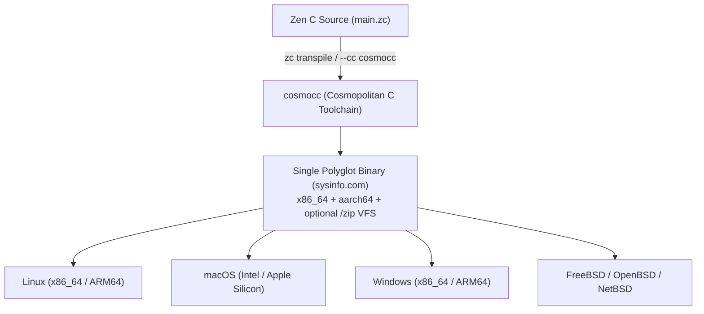

# 15.3 Actually Portable Executables (APE)

What if you could compile a Zen C program **once** on Linux and hand the resulting binary to colleagues on macOS, Windows, FreeBSD, OpenBSD, and NetBSD — across both `x86_64` and `aarch64` (Apple Silicon / ARM64) — with zero virtual machines, containers, or runtime dependencies?

Because Zen C transpiles to standard C11, you can pair `zc` with **[Cosmopolitan Libc](https://github.com/jart/cosmopolitan)** (`cosmocc`) to produce **Actually Portable Executables (`.com`)**. Even better, the Zen C compiler itself (`zc.com`) can be built as an APE binary with the entire Zen C standard library embedded inside it as a `/zip` virtual filesystem.

---

## 1. How Actually Portable Executables Work

An Actually Portable Executable (`.com`) is a polyglot binary header designed by Justine Tunney's Cosmopolitan project that simultaneously encodes:
- A valid **Windows PE/COFF** executable header,
- A valid **POSIX shell script** header that maps and boots the embedded **Linux / BSD / macOS ELF / Mach-O** segments,
- Fat multi-architecture machine code for both **`x86_64`** and **`aarch64`**, and
- An optional **PKZIP archive** at the end of the file accessible at runtime via `/zip/...`.



---

## 2. Installing `cosmocc`

To build APE binaries, download the `cosmocc` toolchain from Cosmopolitan's releases and add its `bin/` directory to your `PATH`:

```bash
mkdir -p ~/cosmocc
cd ~/cosmocc
curl -LO https://cosmo.zip/pub/cosmocc/cosmocc.zip
unzip cosmocc.zip
export PATH="$HOME/cosmocc/bin:$PATH"
```

Verify that `cosmocc` is available:

```console
$ cosmocc --version
```

---

## 3. Compiling a Zen C Program as an APE Binary

Once `cosmocc` is in your `PATH`, pass `--cc cosmocc` to `zc build` (or transpile with `zc transpile` and invoke `cosmocc` directly).

Listing 15-3 uses POSIX `uname(2)` (which Cosmopolitan implements across all six operating systems, including Windows) and checks the `__COSMOPOLITAN__` macro at compile time to report how the binary was built and which OS/architecture it is running on:

**Listing 15-3: `list15-3.zc` — A cross-platform system reporter compatible with both native and APE builds**

```zenc
// File: examples/ch15/ch15-03-portable-ape/main.zc
//
// Native build:   zc build examples/ch15/ch15-03-portable-ape/main.zc -o sysinfo
// Portable build: zc build examples/ch15/ch15-03-portable-ape/main.zc --cc cosmocc -o sysinfo.com
//
// The same source works for both. With cosmocc, the resulting `sysinfo.com`
// runs unmodified on Linux, macOS, Windows, and the BSDs (x86_64 and aarch64).

include <sys/utsname.h>

raw {
    // Report *how* this binary was built (decided at compile time).
    static const char *build_kind(void) {
        #if defined(__COSMOPOLITAN__)
        return "Actually Portable Executable (cosmocc)";
        #else
        return "native executable";
        #endif
    }

    // Report *where* this binary is running (decided at run time).
    // uname(2) is provided by both the host libc and Cosmopolitan Libc.
    static const char *running_os(void) {
        static struct utsname info;
        if (uname(&info) != 0) return "unknown";
        return info.sysname;
    }

    static const char *running_arch(void) {
        static struct utsname info;
        if (uname(&info) != 0) return "unknown";
        return info.machine;
    }
}

extern fn build_kind() -> const char*;
extern fn running_os() -> const char*;
extern fn running_arch() -> const char*;

fn main() {
    println "Build kind : {build_kind()}";
    println "Running on : {running_os()} ({running_arch()})";
    println "Hello from one binary, many operating systems!";
}
```

### Native Build (`gcc` / `clang`)

When compiled normally with `zc run` or `zc build`, `__COSMOPOLITAN__` is not defined and the program links against your host OS's C library:

```console
$ zc run -q examples/ch15/ch15-03-portable-ape/main.zc
Build kind : native executable
Running on : Linux (x86_64)
Hello from one binary, many operating systems!
```

### Portable APE Build (`--cc cosmocc`)

When built with `--cc cosmocc`, `cosmocc` defines `__COSMOPOLITAN__` and links Cosmopolitan's multi-OS fat runtime into `sysinfo.com`:

```bash
zc build examples/ch15/ch15-03-portable-ape/main.zc --cc cosmocc -o sysinfo.com
```

You can now copy `sysinfo.com` onto Linux, macOS, Windows (where the `.com` extension is natively executable in `cmd.exe` and PowerShell), or FreeBSD and run it directly:

```text
Build kind : Actually Portable Executable (cosmocc)
Running on : Linux (x86_64)
Hello from one binary, many operating systems!
```

> [!NOTE]
> When `cosmocc` compiles `sysinfo.com`, it also produces companion intermediate files (`sysinfo.com.dbg` containing DWARF debug symbols and `sysinfo.aarch64.elf` for the ARM64 slice) before merging them into `sysinfo.com`. Only `sysinfo.com` needs to be distributed.

---

## 4. Building the Zen C Compiler Itself as an APE (`zc.com`)

Not only can your Zen C programs be compiled as APE binaries — the **Zen C compiler (`zc`) itself** has first-class APE support in its repository Makefile:

```bash
# Inside the Zen-C compiler repository (with cosmocc in PATH):
make ape
sudo env "PATH=$PATH" make install-ape
```

Running `make ape` builds two self-contained artifacts in `out/bin/`:

| Artifact | Description |
| :--- | :--- |
| **`out/bin/zc.com`** | The portable Zen C compiler. All compiler plugins are statically linked, and the entire `std/` standard library, `std.zc`, and compiler metadata (`zenc.json`, `facts.json`, `docs.json`) are zipped directly into the executable's `/zip/` virtual filesystem. |
| **`out/bin/zc-boot.com`** | A self-contained bootstrapper that extracts a starter project (`hello.zc` and a `Makefile`) and runs `zc.com` out of the box on any supported OS. |

Because `zc.com` embeds `std/` inside `/zip/std`, you can copy the single `zc.com` file onto any machine with a C compiler (or `cosmocc`) and compile Zen C programs without setting `ZC_ROOT` or installing `/usr/local/share/zenc`:

```bash
./out/bin/zc.com build hello.zc -o hello
```

---

## Summary

- **Actually Portable Executables (`.com`)** built with Cosmopolitan's `cosmocc` run natively on Linux, macOS, Windows, FreeBSD, OpenBSD, and NetBSD across `x86_64` and `aarch64`.
- Build any Zen C program as an APE binary with `zc build app.zc --cc cosmocc -o app.com` and detect APE builds in `raw` C blocks via `#ifdef __COSMOPOLITAN__`.
- Build the Zen C compiler itself as a single-file portable toolchain (`out/bin/zc.com`) with `make ape`.
