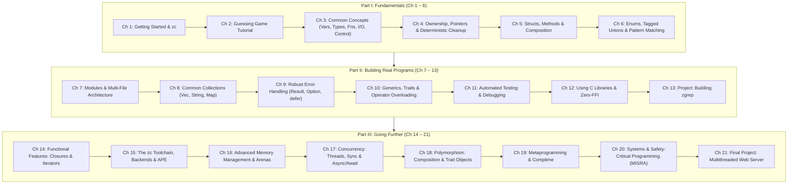

> **Historical Note (Archived):** This document was an early planning artifact from the initial book draft and has been superseded by the current 21-chapter book structure.

# The Zen C Programming Language — Master Book Architecture & Migration Plan

This document serves as the authoritative architectural blueprint and migration specification for rewriting and restructuring **The Zen C Programming Language** tutorial book ([`book/`](file:///home/mark/code/zenc-app/book)).

---

## 1. Executive Summary & Design Principles

The book follows the acclaimed pedagogical pacing of *"The Rust Programming Language"* (The Rust Book), but is specifically architected around Zen C's unique technical realities:

1. **Move-by-Default without a Borrow Checker**: Zen C has deterministic resource management and move semantics, but borrows are done via ergonomic pointers (`T*`, `&x`) and slices. Pointers are introduced in **Chapter 4** as the primary borrowing mechanism rather than deferred to an advanced chapter.
2. **Transpilation Transparency ("🔍 Peek at the C")**: Zen C compiles to clean GNU C11 with zero runtime overhead. Every major language construct includes a sidebar showing what `zc transpile` generates, demystifying the language and building systems intuition.
3. **First-Class Zero-FFI C Interoperability**: In traditional modern languages, C FFI is an isolated, advanced topic. In Zen C, importing C headers (`import "raylib.h"`) and linking libraries is a core, day-to-day capability taught in **Part II (Chapter 12)** before building real projects.
4. **Composition over Inheritance**: Zen C does not have class hierarchies. Object-oriented and polymorphism patterns are taught through struct composition (`use`), method forwarding, and trait objects (vtable fat pointers).
5. **Prerequisite-Strict Hierarchy**: Advanced concepts are never taught before their underlying primitives exist:
   - Operators that require traits are introduced with traits (**Chapter 10**).
   - Closures and heap-capturing lambdas are separated from plain functions and taught in **Chapter 14**.
   - Low-level memory layouts (bitfields, `@packed`, `@align`) are decoupled from basic struct definitions and taught in **Chapter 16**.

---

## 2. Three-Part Book Structure Overview



---

## 3. Detailed Chapter-by-Chapter Architectural Specifications

### Part I: Fundamentals

#### Chapter 1: Getting Started
* **Goal**: Install `zc`, verify the toolchain, and understand the compile/transpile loop.
* **1.1 Installation**: Installing pre-built releases, compiling from source (using `make`, `CMake`, or `zig`), setting environment variable `ZC_ROOT`, validating with `zc --version`.
* **1.2 Hello, World!**: Creating `main.zc`, explaining `fn main()`, running immediately with `zc run main.zc`.
* **1.3 Hello, `zc`!**:
  - Compiling standalone binaries with `zc build main.zc -o hello`.
  - Introducing `zc transpile main.zc -o main.c` to inspect GNU C11 output.
  - Setting compiler optimization levels (`-O2`, `--release`) and selecting backends (`--cc gcc`, `--cc clang`, `--cc tcc`).

#### Chapter 2: Programming a Guessing Game
* **Goal**: Build a complete, interactive CLI application in a single chapter to build confidence.
* **Concepts**: Handling console input with `?` prompt syntax, string interpolation, random numbers with `std/random.zc`, infinite `loop`, and `match` branching.

#### Chapter 3: Common Programming Concepts
* **Goal**: Master language primitives without cognitive overload.
* **3.1 Variables & Constants**: Manifest constants (`def`), type-inferred variables (`let`), read-only constants (`const`).
* **3.2 Data Types**: Scalar numbers (`i8`..`i128`, `u8`..`u128`, `f32`, `f64`, `bool`, `char`, `rune`), fixed-size arrays (`T[N]`), and tuples. Basic arithmetic and bitwise operators.
* **3.3 Functions**: Function declarations (`fn`), parameter types, return types (`->`), named arguments, `const` arguments, default parameter values. *(Closures and raw function pointers moved to Ch 14; variadics moved to Ch 12).*
* **3.4 Comments, Printing & String Interpolation**: Keywords (`print`, `println`, `eprint`, `eprintln`), shorthand prefixes (`"Hz"`, `!"Err"`), interpolation `{var}`, raw strings (`r"..."`), multiline strings (`"""..."""`), input prompts (`?`).
* **3.5 Control Flow**: `if` expressions, ternary operator, `while` / `do-while`, `for ..` range loops, enumerated iteration, labeled `loop`, `guard ... else { return; }`, and `unless`.

#### Chapter 4: Ownership, Pointers & Deterministic Cleanup
* **Goal**: Teach Zen C's resource lifecycle: how move semantics prevent double-frees, how pointers act as borrows, and how `defer`/`Drop` guarantee cleanup.
* **4.1 Stack, Heap & Move Semantics**:
  - Stack allocation vs heap allocation in C11.
  - Resource semantics: why types with destructors move on assignment and function calls.
  - Compiler diagnostics: "Use of moved value".
  - Explicit deep copies with `.clone()` and stack value types via `@derive(Copy)`.
* **4.2 Pointers as Borrows**:
  - Creating pointers (`&val`) and referencing (`T*`).
  - Auto-dereference feature (`ptr.field` and `ptr.method()` without `->` or `*`).
  - Safe navigation (`ptr?.field`) and null-coalescing (`ptr ?? fallback`, `ptr ??= default`).
  - *Contrast with Rust*: Pointers in Zen C are borrows, but lifetime validation is the developer's responsibility.
* **4.3 Slices**:
  - Contiguous views into arrays and buffers without duplication (`slice.zc`).
* **4.4 Deterministic Cleanup**:
  - `defer` statements and their LIFO execution order.
  - `autofree` for raw `malloc` buffers.
  - Custom RAII cleanup via the `Drop` trait (`fn drop(self)`).
  - Disarming destructors: the `.forget()` method for manual ownership handoffs.

#### Chapter 5: Structs and Composition
* **Goal**: Structure custom data types and model relationships using composition instead of inheritance.
* **5.1 Defining and Instantiating Structs**: Syntax, complete field initialization rule, zero-initialization (`Struct{}`), field access, destructuring into local variables.
* **5.2 An Example Program Using Structs**: Step-by-step implementation of `Rectangles` (calculating area, scaling, and bounding boxes).
* **5.3 Method Syntax and `impl` Blocks**:
  - Read-only methods (`const self`) vs mutating methods (`self`).
  - Self shorthand (`.field`).
  - Associated constructor functions (`Type::new()`) and the `Self` return type.
  - Attaching methods to primitives (`impl int`).
* **5.4 Struct Composition with `use`**:
  - Unnamed mixin flattening (`use Entity;`).
  - Named composition (`use origin: Point;`).
  - Automatic method forwarding across mixin hierarchies.

#### Chapter 6: Enums and Pattern Matching
* **Goal**: Represent sum types (tagged unions) safely and write exhaustive match expressions.
* **6.1 Defining Enums as Tagged Unions**:
  - Unit variants, single-payload variants, and tuple payloads.
  - Under the hood: C11 discriminant tag byte + overlapping `union`.
  - Methods on enums (`impl EnumName`).
  - Core types: `Option<T>` (`Some`/`None`) and `Result<T, E>` (`Ok`/`Err`).
* **6.2 The `match` Construct**:
  - Exhaustive matching, wildcard `_`, or-patterns (`||`).
  - Destructuring payloads and range matching.
* **6.3 Patterns and Destructuring Everywhere**:
  - Reference binding (`ref`) to inspect payloads without moving ownership.
  - Destructuring in `let` assignments and `for` loops.

---

### Part II: Building Real Programs

#### Chapter 7: Modules and Multi-File Projects
* **Goal**: Organize growing codebases with clean encapsulation.
* **7.1 Modules and Imports**: File-based modules, importing symbols, namespace aliases (`as alias`), wildcards (`as *`), selective imports (`import { ... } from "..."`).
* **7.2 Directory Modules & Re-exports**: Structuring packages with `mod.zc`, re-exporting with `export import`.
* **7.3 Encapsulation with `opaque`**:
  - `opaque struct`: True private fields with zero-overhead stack allocation.
  - `opaque alias`: Strong nominal types (e.g. `UserID` vs `OrderID`).
* **7.4 Circular Dependency Detection & Project Layout**: How `zc` prevents cyclic imports, standard project layout, `ZC_ROOT`.

#### Chapter 8: Common Collections
* **Goal**: Master Zen C's core dynamic data structures.
* **8.1 Vectors (`Vec<T>`)**: Dynamic arrays, internal capacity growth, indexing, bounds checking, iterating by value vs by reference.
* **8.2 Strings**: Differences between `string` (immutable view), `String` (growable heap buffer), and `char*`. UTF-8 validation and rune indexing.
* **8.3 Hash Maps (`Map<V>`) and Sets (`Set<T>`)**: Key-value mappings, hash sets, lookup semantics, automatic memory cleanup with `Drop`.
* **Capstone**: Building a frequency text analyzer.

#### Chapter 9: Error Handling
* **Goal**: Write production-grade, fault-tolerant systems code.
* **9.1 Unrecoverable Errors**: `panic()`, assertions, stack traces.
* **9.2 Recoverable Errors with `Result<T, E>`**: Handling errors with `match`, the `?` try operator, chaining results.
* **9.3 Combining `?` with `defer`**: Ensuring handles and buffers are safely freed when error returns trigger early.
* **9.4 Bridging C `errno` & Return Codes**: Wrapping POSIX/C library return codes into clean `Result` types.
* **9.5 Guidelines**: When to panic vs when to return `Result`.

#### Chapter 10: Generics, Traits & Operator Overloading
* **Goal**: Write reusable, type-safe abstractions with zero runtime cost.
* **10.1 Generic Data Types & Functions**: Monomorphization and how generic structs transpile into specialized C11 structs.
* **10.2 Traits: Defining Shared Behavior**: Declaring traits, implementing traits for custom structs, trait bounds.
* **10.3 Standard Traits & Derives**: `Drop`, `Clone`, `Copy`, `Iterable<T>`, and `@derive(Copy, Clone)`.
* **10.4 Operator Overloading**: Arithmetic (`add`, `sub`, `mul`, `div`), comparison (`eq`, `lt`), and indexing (`get`, `set`).

#### Chapter 11: Testing & Debugging
* **Goal**: Write automated tests and debug Zen C applications with industry-standard tools.
* **11.1 Writing Automated Tests**: `test "name" { ... }` blocks, assertion macros (`assert`, `assert_eq`).
* **11.2 Running Tests with `zc test`**: Test execution, filtering tests, test suites, and CI integration.
* **11.3 Debugging with GDB, LLDB, and VS Code**: Generating debug symbols (`-g`), stepping through `.zc` source files, setting breakpoints.

#### Chapter 12: Using C Libraries (Zero-FFI Interoperability)
* **Goal**: Leverage existing C ecosystems directly without glue code.
* **12.1 Trusted Header Imports vs Includes**:
  - `import "sqlite3.h" as sqlite;` (semantic module import).
  - `include <stdio.h>` (preprocessor emission).
* **12.2 Explicit FFI Signatures**: Declaring external C functions, managing `void*` contexts.
* **12.3 C Types, Strings, and Variadics**: Converting between `string` and `char*`, handling variadics (`...`, `va_list`).
* **12.4 Build Directives & Linking**: Linking flags (`-lraylib`, `-I/usr/include`), `#pragma link`.
* **Capstone**: Creating an interactive graphical window with Raylib or querying SQLite.

#### Chapter 13: An I/O Project: Building `zgrep`
* **Goal**: Synthesize Chapters 7–12 into a complete, polished command-line tool.
* **Features**: Argument parsing, stream file I/O (`std/fs.zc`), regex matching (`std/regex.zc`), error handling, case insensitivity via environment variables (`std/env.zc`), test coverage.

---

### Part III: Going Further

#### Chapter 14: Functional Features: Closures and Iterators
* **14.1 Closures (Lambdas)**: Arrow syntax (`x -> x + 1`), capture by value (`[=]`), capture by reference (`[&]`).
* **14.2 Raw Function Pointers (`fn*`)**: Zero-overhead function pointers without environment state for C callback compatibility.
* **14.3 Iterators & Iterator Adapters**: `Iterable<T>` trait, `map`, `filter`, `fold`, lazy evaluation.
* **14.4 Performance & Under the Hood**: What closures compile to in C11 (hidden env structs vs function pointers).

#### Chapter 15: The `zc` Compiler Toolchain & Backends
* **15.1 Pluggable C Backends**: GCC, Clang, TinyCC (`--cc tcc` for instant compile cycles), and Zig (`zc --cc zig` for zero-setup cross-compilation).
* **15.2 Inspecting Generated Code**: Deep dive into `zc transpile`, reading Zen C name mangling rules, verifying zero-cost abstractions.
* **15.3 Truly Portable Binaries**: Building Actually Portable Executables (APE) that run unmodified across Linux, macOS, FreeBSD, and Windows.
* **15.4 Developer Tooling**: `zc-doc`, `zc-format`, `zc-repl` interactive shell, and Language Server Protocol (`zc-lsp`).

#### Chapter 16: Advanced Memory Management
* **16.1 Raw Pointer Operations**: Pointer arithmetic, unchecked dereferencing, casting between pointer types, `void*`.
* **16.2 Custom Allocators & Arenas**: Regional memory allocation with `std/arena.zc`, resetting arenas, eliminating allocator fragmentation.
* **16.3 Low-Level Struct Layout**: Bitfields (`flags: u8 : 1`), memory packing (`@packed`), and alignment constraints (`@align(N)`).
* **16.4 Untagged Unions**: Memory reinterpretation for hardware drivers and network packet serialization.

#### Chapter 17: Concurrency
* **17.1 OS Threads**: Creating threads with `std/thread.zc`, thread handles, passing moved data to thread workers.
* **17.2 Synchronization Primitives**: Mutexes (`Mutex`), read-write locks, atomic operations (`std/sync.zc`).
* **17.3 Message Passing**: Concurrent queues and worker-pool channels.
* **17.4 Asynchronous Programming with `async`/`await`**:
  - Syntax and semantics: `async fn`, awaiting tasks.
  - How Zen C's async maps to native pthreads under the hood.
  - Trade-offs compared to Rust's poll-based state machine model.

#### Chapter 18: Polymorphism: Composition & Trait Objects
* **18.1 OOP Philosophy in Zen C**: Why Zen C rejects class hierarchies and multiple inheritance in favor of composition and interfaces.
* **18.2 Trait Objects & Dynamic Dispatch**: Fat pointers (`let d: Drawable = &circle;`), runtime method resolution.
* **18.3 Vtables in Generated C**: Inspecting how `zc` generates virtual method tables in pure C11 structs.
* **18.4 Practical Design Pattern**: Implementing a state machine using traits and dynamic dispatch.

#### Chapter 19: Metaprogramming & Compile-Time Execution
* **19.1 `comptime`**: Running Zen C code at compile time, computing lookup tables, compile-time assertions.
* **19.2 Attributes & Smart Derives**: Built-in attributes, custom user attributes, code generation.
* **19.3 Static File Embedding & Plugins**: Embedding assets at compile time with `@embed`, compiler plugins.
* **19.4 Conditional Compilation**: Environment checks, target OS and architecture switching.

#### Chapter 20: Systems & Safety-Critical Programming
* **20.1 Inline Assembly**: `asm` blocks, registers, named constraints, and `volatile`.
* **20.2 Native SIMD Vectorization**: Hardware vector types (`std/simd.zc`), parallel lane arithmetic.
* **20.3 MISRA C:2012 Compliance Mode**:
  - Compiling with `--misra`.
  - Enforced rules (exhaustive enum checks, no raw preprocessor directives, shadowing restrictions, etc.).
* **20.4 Polyglot Interop**: Interfacing directly with C++, Objective-C, and CUDA kernels (`<<<grid, block>>>`).
* **20.5 Embedding Zen C**: Linking Zen C modules into existing C/C++ applications via public C headers (`zc_core.h`).

#### Chapter 21: Final Project: Building a High-Performance Multithreaded Web Server
* **21.1 Single-Threaded HTTP Server**: Raw TCP sockets (`std/net`), HTTP request parsing, response formatting.
* **21.2 Thread Pool Architecture**: Fixed worker pool, work queue, dispatching requests without thread creation overhead.
* **21.3 Graceful Shutdown & Cleanup**: Trapping signals, draining the request queue, cleaning up connections with `Drop` and `defer`.

---

## 4. Appendices

* **Appendix A: Keywords & Reserved Identifiers**
* **Appendix B: Complete Operators and Syntactic Sugar Table**
* **Appendix C: Zen C Standard Library Comprehensive Tour** *(The extensive module index relocated from Ch 7)*
* **Appendix D: Development Environment Setup** (VS Code extension, Vim/Neovim, LSP configuration)
* **Appendix E: MISRA C Compliance Rules Reference**
* **Appendix F: Zen C for C and Rust Programmers (Rosetta Stone Comparison)**
* **Appendix G: Diagnostic Codes, Warnings, and Compiler Flags**

---

## 5. Exact Content Migration Map for Existing Chapters (1–8)

| Current Source File | Section to Move | Destination File | Notes |
|---|---|---|---|
| `ch03-03-functions-and-lambdas.md` | Lambdas & Closures (lines 89–157) | `ch14-01-lambdas.md` | Keep basic functions in `ch03-03-functions.md` |
| `ch03-03-functions-and-lambdas.md` | Raw Function Pointers `fn*` (lines 159–194) | `ch14-02-fn-pointers.md` | Advanced C callback feature |
| `ch03-03-functions-and-lambdas.md` | Variadics `...` and `va_list` (lines 196–220) | `ch12-03-c-types-variadics.md` | C Interop feature |
| `ch03-04-control-flow.md` | Deep `match` & `ref` (lines 50–140) | `ch06-02-match.md` & `ch06-03-patterns.md` | Keep brief preview in Ch 3, deep dive in Ch 6 |
| `ch03-05-operators.md` | Overloadable operators (lines 7–102) | `ch10-04-operator-overloading.md` | Consolidate with method overloading in Ch 10 |
| `ch03-05-operators.md` | Pointer sugar `?.`, `??`, `??=`, auto-deref (lines 173–289) | `ch04-02-pointers.md` | Belongs directly with pointer borrowing |
| `ch03-05-operators.md` | Try operator `?` (lines 241–252) | `ch09-02-option-and-result.md` | Belongs with Result error handling |
| `ch03-06-printing...md` | Whole section | `ch03-04-printing-and-interpolation.md` | Renumbered to come before Control Flow |
| `ch04-01-drop-and-raii.md` | Whole section | `ch04-04-cleanup.md` | Reordered: Move semantics and pointers taught before cleanup |
| `ch04-02-ownership...md` | Whole section | `ch04-01-move-semantics.md` | Placed first in Ch 4 |
| `ch05-01-defining-structs.md` | Composition `use` (lines 193–266) | `ch05-04-composition.md` | Dedicated sub-chapter for mixins |
| `ch05-01-defining-structs.md` | Bitfields, `@packed`, `@align` (lines 268–375) | `ch16-03-struct-layout.md` | Low-level layout deferred to Ch 16 |
| `examples/ch05/rectangles/` | Runnable example | `ch05-02-example-structs.md` | New narrative chapter matching the Rust Book |
| `ch05-02-method-syntax.md` | Operator overloading (lines 277–406) | `ch10-04-operator-overloading.md` | Consolidated with operator chapter |
| `ch07-01-modules...md` | Section 7: C Header Imports (lines 385–440) | `ch12-01-c-headers.md` | Promoted to dedicated C interop chapter |
| `ch07-02-std...md` | Full catalog (lines 30–420) | `appendix-03-std-tour.md` | Replaced by high-level narrative in Ch 7 |

---

## 6. Authoritative `SUMMARY.md`

```markdown
# Summary

[The Zen C Programming Language](ch00-00-introduction.md)

# Part I — Fundamentals

- [Getting Started](ch01-00-getting-started.md)
    - [Installation](ch01-01-installation.md)
    - [Hello, World!](ch01-02-hello-world.md)
    - [Hello, zc!](ch01-03-hello-zc.md)

- [Programming a Guessing Game](ch02-00-guessing-game-tutorial.md)

- [Common Programming Concepts](ch03-00-common-programming-concepts.md)
    - [Variables and Constants](ch03-01-variables-and-constants.md)
    - [Data Types](ch03-02-data-types.md)
    - [Functions](ch03-03-functions.md)
    - [Comments, Printing and Interpolation](ch03-04-printing-and-interpolation.md)
    - [Control Flow](ch03-05-control-flow.md)

- [Ownership, Pointers and Cleanup](ch04-00-ownership-pointers-cleanup.md)
    - [Stack, Heap and Move Semantics](ch04-01-move-semantics.md)
    - [Pointers as Borrows](ch04-02-pointers.md)
    - [Slices](ch04-03-slices.md)
    - [Deterministic Cleanup: defer, autofree and Drop](ch04-04-cleanup.md)

- [Structs and Composition](ch05-00-structs.md)
    - [Defining and Instantiating Structs](ch05-01-defining-structs.md)
    - [An Example Program Using Structs](ch05-02-example-structs.md)
    - [Method Syntax](ch05-03-method-syntax.md)
    - [Composition with use](ch05-04-composition.md)

- [Enums and Pattern Matching](ch06-00-enums.md)
    - [Defining an Enum](ch06-01-defining-an-enum.md)
    - [The match Construct](ch06-02-match.md)
    - [Patterns and Destructuring](ch06-03-patterns.md)

# Part II — Building Real Programs

- [Modules and Multi-File Projects](ch07-00-modules.md)
    - [Modules and Imports](ch07-01-modules-and-imports.md)
    - [Directory Modules and Re-exports](ch07-02-directory-modules.md)
    - [Encapsulation with opaque](ch07-03-encapsulation.md)
    - [Circular Dependency Prevention](ch07-04-circular-dependencies.md)

- [Common Collections](ch08-00-common-collections.md)
    - [Vectors (Vec)](ch08-01-vectors.md)
    - [Strings](ch08-02-strings.md)
    - [Hash Maps and Sets](ch08-03-hash-maps.md)

- [Error Handling](ch09-00-error-handling.md)
    - [Unrecoverable Errors with panic](ch09-01-panic.md)
    - [Recoverable Errors with Result and Option](ch09-02-option-and-result.md)
    - [Cleanup on Error Paths with defer](ch09-03-defer-cleanup.md)
    - [Bridging C Return Codes and errno](ch09-04-c-errors.md)
    - [To panic or Not to panic](ch09-05-panic-guidelines.md)

- [Generics, Traits & Operator Overloading](ch10-00-generics-and-traits.md)
    - [Generic Data Types](ch10-01-generic-data-types.md)
    - [Traits: Defining Shared Behavior](ch10-02-traits.md)
    - [Standard Traits and Smart Derives](ch10-03-standard-traits.md)
    - [Operator Overloading](ch10-04-operator-overloading.md)

- [Writing Automated Tests](ch11-00-testing.md)
    - [How to Write Tests](ch11-01-writing-tests.md)
    - [Running Tests with zc test](ch11-02-running-tests.md)
    - [Debugging with GDB, LLDB, and VS Code](ch11-03-debugging.md)

- [Using C Libraries](ch12-00-using-c-libraries.md)
    - [C Header Imports vs Includes](ch12-01-c-headers.md)
    - [Explicit FFI Declarations](ch12-02-ffi-declarations.md)
    - [C Types, Strings, and Variadics](ch12-03-c-types-variadics.md)
    - [Linking and Build Directives](ch12-04-linking-directives.md)
    - [Hands-on Example: Raylib Graphics Window](ch12-05-raylib-example.md)

- [An I/O Project: Building zgrep](ch13-00-cli-project.md)
    - [Accepting Command Line Arguments](ch13-01-cli-arguments.md)
    - [Reading a File](ch13-02-reading-file.md)
    - [Refactoring to Improve Modularity and Error Handling](ch13-03-refactoring.md)
    - [Working with Environment Variables](ch13-04-env-variables.md)
    - [Writing Error Messages to Standard Error](ch13-05-stderr.md)

# Part III — Going Further

- [Functional Features: Closures and Iterators](ch14-00-functional-features.md)
    - [Lambdas and Closure Capture](ch14-01-lambdas.md)
    - [Raw Function Pointers (fn*)](ch14-02-fn-pointers.md)
    - [Processing Items with Iterators](ch14-03-iterators.md)
    - [Comparing Performance: Loops vs Iterators](ch14-04-performance.md)

- [The zc Toolchain and Compiler Backends](ch15-00-toolchain.md)
    - [Configuring Compiler Backends](ch15-01-compiler-backends.md)
    - [Inspecting Generated C and Name Mangling](ch15-02-generated-c.md)
    - [Actually Portable Executables (APE)](ch15-03-portable-ape.md)
    - [Developer Tooling: zc-doc, zc-format, REPL, and LSP](ch15-04-developer-tooling.md)

- [Advanced Memory Management](ch16-00-advanced-memory-management.md)
    - [Raw Pointers and Unsafe Operations](ch16-01-raw-pointers.md)
    - [Arena Allocators](ch16-02-arenas.md)
    - [Low-Level Struct Layout: Bitfields, Packing, and Alignment](ch16-03-struct-layout.md)
    - [Untagged Unions](ch16-04-unions.md)

- [Concurrency](ch17-00-concurrency.md)
    - [Using Threads to Run Code Simultaneously](ch17-01-threads.md)
    - [Shared-State Concurrency: Mutex and Atomics](ch17-02-mutex-sync.md)
    - [Message Passing with Queues](ch17-03-message-passing.md)
    - [Asynchronous Programming with async/await](ch17-04-async-await.md)

- [Polymorphism: Composition and Trait Objects](ch18-00-polymorphism.md)
    - [Object-Oriented Characteristics of Zen C](ch18-01-oop-characteristics.md)
    - [Trait Objects for Dynamic Dispatch](ch18-02-trait-objects.md)
    - [Vtables Under the Hood in C11](ch18-03-vtables-in-c.md)
    - [Implementing an Object-Oriented Design Pattern](ch18-04-oop-patterns.md)

- [Metaprogramming and Compile-Time Execution](ch19-00-metaprogramming.md)
    - [Compile-Time Execution (comptime)](ch19-01-comptime.md)
    - [Attributes and Smart Derives](ch19-02-attributes-derives.md)
    - [Asset Embedding (@embed) and Compiler Plugins](ch19-03-embed-plugins.md)
    - [Conditional Compilation and Generic C Macros](ch19-04-conditional-macros.md)

- [Systems and Safety-Critical Programming](ch20-00-systems.md)
    - [Inline Assembly and Volatile](ch20-01-inline-assembly.md)
    - [Native SIMD Vectorization](ch20-02-simd.md)
    - [MISRA C:2012 Compliance Mode](ch20-03-misra-mode.md)
    - [Polyglot Interoperability: C++, Objective-C, and CUDA](ch20-04-cpp-objc-cuda.md)
    - [Embedding Zen C in C Programs](ch20-05-embedding-zc.md)

- [Final Project: Building a Multithreaded Web Server](ch21-00-final-project.md)
    - [Building a Single-Threaded Web Server](ch21-01-single-threaded.md)
    - [Turning Our Single-Threaded Server into a Multithreaded Server](ch21-02-multithreaded.md)
    - [Graceful Shutdown and Cleanup](ch21-03-graceful-shutdown.md)

# Appendix

- [Appendix A: Keywords](appendix-01-keywords.md)
- [Appendix B: Operators and Syntactic Sugar](appendix-02-operators.md)
- [Appendix C: Zen C Standard Library Comprehensive Tour](appendix-03-std-tour.md)
- [Appendix D: Development Tools and Editors](appendix-04-dev-tools.md)
- [Appendix E: MISRA C Compliance Rules Reference](appendix-05-misra-rules.md)
- [Appendix F: Zen C for C and Rust Programmers](appendix-06-cheatsheet.md)
- [Appendix G: Diagnostics and Compiler Options](appendix-07-diagnostics.md)
```

---

## 7. Migration Automation Script

To execute this architectural transformation cleanly on the repository, you can execute the following bash commands inside `/home/mark/code/zenc-app/book`:

```bash
#!/usr/bin/env bash
set -e

cd /home/mark/code/zenc-app/book

# 1. Update .gitignore
cat << 'EOF' >> .gitignore

# Executables & swap files
hello
*.swp
*.swo
sandbox/
EOF

# 2. Create stub files for new chapters and appendices so mdbook build succeeds
touch ch03-03-functions.md
touch ch03-04-printing-and-interpolation.md
touch ch03-05-control-flow.md

touch ch04-00-ownership-pointers-cleanup.md
touch ch04-01-move-semantics.md
touch ch04-02-pointers.md
touch ch04-03-slices.md
touch ch04-04-cleanup.md

touch ch05-02-example-structs.md
touch ch05-03-method-syntax.md
touch ch05-04-composition.md

touch ch06-00-enums.md
touch ch06-03-patterns.md

touch ch07-00-modules.md
touch ch07-02-directory-modules.md
touch ch07-03-encapsulation.md
touch ch07-04-circular-dependencies.md

touch ch09-03-defer-cleanup.md
touch ch09-04-c-errors.md
touch ch09-05-panic-guidelines.md

touch ch10-03-standard-traits.md
touch ch10-04-operator-overloading.md

touch ch11-03-debugging.md

touch ch12-00-using-c-libraries.md
touch ch12-01-c-headers.md
touch ch12-02-ffi-declarations.md
touch ch12-03-c-types-variadics.md
touch ch12-04-linking-directives.md
touch ch12-05-raylib-example.md

touch ch13-01-cli-arguments.md
touch ch13-02-reading-file.md
touch ch13-03-refactoring.md
touch ch13-04-env-variables.md
touch ch13-05-stderr.md

touch ch14-00-functional-features.md
touch ch14-01-lambdas.md
touch ch14-02-fn-pointers.md
touch ch14-03-iterators.md
touch ch14-04-performance.md

touch ch15-00-toolchain.md
touch ch15-01-compiler-backends.md
touch ch15-02-generated-c.md
touch ch15-03-portable-ape.md
touch ch15-04-developer-tooling.md

touch ch16-00-advanced-memory-management.md
touch ch16-01-raw-pointers.md
touch ch16-02-arenas.md
touch ch16-03-struct-layout.md
touch ch16-04-unions.md

touch ch17-00-concurrency.md
touch ch17-01-threads.md
touch ch17-02-mutex-sync.md
touch ch17-03-message-passing.md
touch ch17-04-async-await.md

touch ch18-00-polymorphism.md
touch ch18-01-oop-characteristics.md
touch ch18-02-trait-objects.md
touch ch18-03-vtables-in-c.md
touch ch18-04-oop-patterns.md

touch ch19-00-metaprogramming.md
touch ch19-02-attributes-derives.md
touch ch19-03-embed-plugins.md
touch ch19-04-conditional-macros.md

touch ch20-00-systems.md
touch ch20-01-inline-assembly.md
touch ch20-02-simd.md
touch ch20-03-misra-mode.md
touch ch20-04-cpp-objc-cuda.md
touch ch20-05-embedding-zc.md

touch ch21-00-final-project.md
touch ch21-01-single-threaded.md
touch ch21-02-multithreaded.md
touch ch21-03-graceful-shutdown.md

touch appendix-01-keywords.md
touch appendix-02-operators.md
touch appendix-03-std-tour.md
touch appendix-04-dev-tools.md
touch appendix-05-misra-rules.md
touch appendix-06-cheatsheet.md
touch appendix-07-diagnostics.md

# 3. Build verification
mdbook build
```
