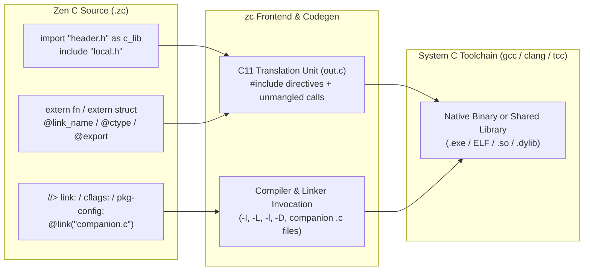

# 第 12 章：使用 C 语言库（FFI 与互操作）

大多数现代系统级语言将与 C 的互操作性视为**外部函数接口（FFI, Foreign Function Interface）**——这是一道边界，数据结构必须在此边界两侧进行转换，字符串必须被复制或封送（marshal），头文件需要通过外部代码生成工具（如 `bindgen` 或 `cgo`）进行转换，构建脚本也需要用单独的语言进行配置。

Zen C 采取了一种根本不同的方式：**对 Zen C 而言，C 并不是“外部”语言**。因为 Zen C 编译器（`zc`）直接转译为标准 C11，并调用系统 C 编译器（`gcc`、`clang` 或 `tcc`），所以 Zen C 与 C 共享**完全相同的应用程序二进制接口（ABI）**、调用约定、结构体内存布局以及预处理器生态系统。

从 Zen C 调用 C 函数——或将 Zen C 函数导出给 C——具有**零运行时开销**：

- **无封送或包装胶水代码**：Zen C 指针（`T*`）、结构体或基本整数直接通过平台 C ABI 指定的硬件寄存器进行传递。
- **直接使用头文件**：你可以将标准库或第三方 `.h` 文件直接导入到 Zen C 命名空间中（`import "zlib.h" as zlib;`），或直接包含本地项目头文件（`include "sensor_hal.h"`），而无需预先运行外部绑定生成器。
- **自包含的构建指令**：库链接标志（`//> link: -lm`）、头文件搜索路径（`//> include: ./vendor`）、`pkg-config` 查询（`//> pkg-config: sdl2`）以及伴随的 `.c` 源文件（`@link("crc16.c")`）都可以直接在 `.zc` 源文件中声明，因此 `zc run` 和 `zc build` 开箱即用。

---

## 选择合适的互操作机制

Zen C 提供了几种互补的与 C 代码接口的方式，具体取决于你是想要快速探索性地访问 C 头文件、严格的类型检查签名，还是清晰的多平台构建配置：

| 机制 | 语法 | 最佳适用场景... |
| :--- | :--- | :--- |
| **带命名空间的头文件导入** | `import "math.h" as c_math;` | 希望在清晰的模块前缀下调用 C 头文件中的函数或引用类型（`c_math::hypot(3.0, 4.0)`），且不污染全局命名空间。 |
| **本地头文件包含** | `include "sensor_hal.h"` | 拥有本地 C 头文件，并希望其 `#define` 整数常量、`typedef struct` 定义和函数原型被自动扫描到 Zen C 的符号表中。 |
| **系统头文件包含** | `include <stdio.h>` | 需要在显式 `extern fn` 声明或 `zenc.json` 白名单旁发射标准 C 预处理器 `#include <...>` 指令。 |
| **显式 FFI 声明** | `extern fn`、`extern struct`、`extern let` | 希望对参数和返回值进行完整的 Zen C 类型检查——即使不包含 `.h` 文件——或者希望将 C 实现细节隐藏在不透明指针（`MockDb*`）之后。 |
| **FFI 属性** | `@link_name`、`@ctype`、`@crepr`、`@export` | 需要对产生冲突的 C 符号进行重命名、在 C 指针参数上保留 `const` 限定符，或在共享库（`zc build -shared`）中将 Zen C 函数导出给 C 调用方。 |
| **构建指令** | `//> link:`、`//> pkg-config:`、`@link("file.c")` | 希望 `zc build` 和 `zc run` 自动传递 `-I`、`-L`、`-l`、`-D` 或 `-framework` 标志，并在 Linux、macOS 和 Windows 上编译伴随的 `.c` 文件。 |

---

## 本章你将学到什么

1. **[12.1 C 头文件导入与包含](ch12-01-c-headers.md)**：理解 `import "header.h" as alias`、`include <header.h>` 和 `include "local.h"` 之间的区别，了解 Zen C 的自动头文件扫描器如何注册 C 符号，以及如何在 `zenc.json` 中配置 C 函数和类型的白名单。
2. **[12.2 显式 FFI 声明](ch12-02-ffi-declarations.md)**：声明带类型的 `extern fn` 签名、不透明的 `extern struct` 和 `extern union` 句柄、外部 C 全局变量（`extern let`）、符号别名（`@link_name`）、共享库导出（`@export`）以及内联 `raw { ... }` C 代码块。
3. **[12.3 C 类型、字符串与变长参数](ch12-03-c-types-variadics.md)**：掌握跨 LP64（Linux/macOS）和 LLP64（Windows）平台的可移植 C ABI 类型（`c_int`、`c_long`、`usize`、`void*`），使用 `@ctype("const char*")` 安全传递字符串，以及调用和编写 C 变长参数函数（`...`、`va_list`、`va_start`、`va_arg`、`va_end`）。
4. **[12.4 链接与构建指令](ch12-04-linking-directives.md)**：配置链接器库、编译器标志、包含/库路径、macOS framework、预处理器宏定义、`pkg-config` 依赖包、操作系统条件指令（`//> linux:`、`//> macos:`、`//> windows:`）以及伴随 `.c` 文件（`@link`）。
5. **[12.5 实战示例：Raylib 图形窗口](ch12-05-raylib-example.md)**：综合运用本章所学知识，使用 Raylib 的 C API、自动 `defer` 窗口清理以及按值传递的 C 结构体（`Vector2`、`Color`）构建一个跨平台的图形与物理模拟循环。
