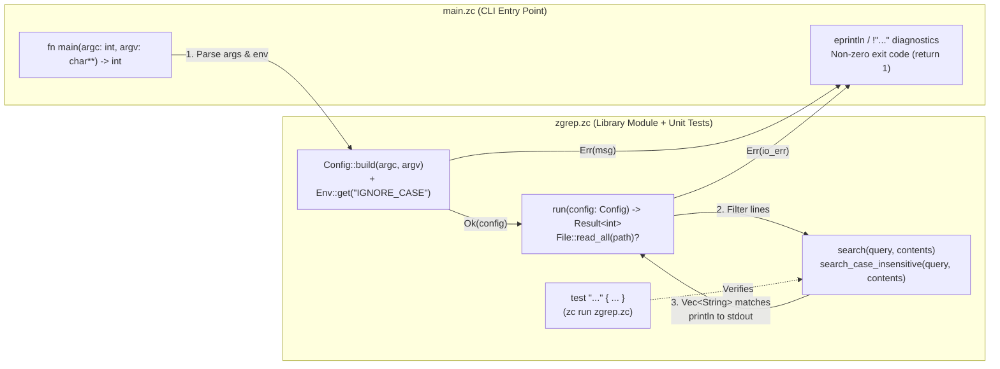

# 第 13 章：I/O 项目：构建 `zgrep`

在前面的十二章中，我们探讨了 Zen C 的核心基础——所有权、指针、结构体、枚举、模块、动态集合（`Vec<T>`、`String`）、可恢复错误处理（`Result<T>`、`Option<T>`、`?`）、泛型、自动化 `test` 块以及零开销 C 互操作。

为了巩固这些概念，并了解它们如何在真实的系统级应用程序中协同工作，我们将在本章构建 **`zgrep`**（Zen C **g**lobally search a **r**egular **e**xpression and **p**rint）：一个快速、自包含的命令行搜索工具，模仿经典的 Unix `grep` 实用程序。

在最基本的形式中，`zgrep` 接受搜索查询字符串和文件路径作为命令行参数，从磁盘读取目标文件，扫描每一行以查找查询字符串，并将匹配的行打印到标准输出：

```bash
$ zc build main.zc -o zgrep
$ ./zgrep frog poem.txt
How public, like a frog
```

在实现过程中，我们的 `zgrep` 实现将综合运用本书第一部分和第二部分的特性：

| 概念 | 学习章节 | `zgrep` 如何使用它 |
| :--- | :--- | :--- |
| **模块与封装** | [第 7 章](ch07-00-modules.md) | 将轻量 CLI 入口点（`main.zc`）与可测试的核心库模块（`zgrep.zc`）分离。 |
| **集合（`String` 与 `Vec<T>`）** | [第 8 章](ch08-00-common-collections.md) | 将文件内容读取到堆分配的 `String` 中，将行切分为 `Vec<String>`，并使用 `.to_lowercase()` 规范化大小写。 |
| **错误处理（`Result<T>` 与 `?`）** | [第 9 章](ch09-00-error-handling.md) | 解析参数时返回 `Result<Config>`，并使用 `File::read_all(path)?` 传播文件 I/O 错误。 |
| **RAII 清理（`Drop` 与 `defer`）** | [第 4 章](ch04-00-ownership-pointers-cleanup.md) | 在每个返回路径上自动关闭操作系统文件句柄并释放临时行缓冲区，无需手动调用 `free()`。 |
| **模块内单元测试（`test`）** | [第 11 章](ch11-00-testing.md) | 直接在 `zgrep.zc` 内部编写测试驱动的 `test "..."` 块，并通过 `zc run zgrep.zc` 运行它们。 |
| **C ABI 入口点与 I/O 流** | [第 3 章](ch03-04-printing-and-interpolation.md) 与 [第 12 章](ch12-00-using-c-libraries.md) | 接受 `fn main(argc: int, argv: char**) -> int`，通过 `std/env.zc` 读取环境变量，并分离 `stdout`（`println`）与 `stderr`（`eprintln` / `!"..."`）。 |

---

## `zgrep` 的架构

在本章结束时，我们的项目将遵循地道的 Zen C **双目标 CLI 架构**：一个微小的 `main.zc` 二进制入口点，搭配一个具有自测试能力的 `zgrep.zc` 库模块。



将 `main.zc` 与 `zgrep.zc` 分离为我们带来了两大核心优势：
1. **清晰的关注点分离**：`main.zc` 仅处理进程级别的关注点——传递 `argc`/`argv`、将面向用户的错误格式化输出到 `stderr`，以及返回操作系统退出码（`0` 或 `1`）。所有实际的领域逻辑都位于 `zgrep.zc` 中。
2. **零摩擦测试**：因为 `zgrep.zc` 没有 `fn main()`，运行 `zc run zgrep.zc` 会自动合成测试运行器并执行所有内嵌的 `test "..."` 块，而 `zc build main.zc -o zgrep` 则编译完整的命令行二进制程序。

---

## 本章路线图

我们将分五个小节逐步构建 `zgrep`：

1. **[13.1 接收命令行参数](ch13-01-cli-arguments.md)**：在 `fn main(argc: int, argv: char**) -> int` 中检查 `argc` 和 `argv`，提取搜索查询与文件路径，并使用 `zc build` 构建 CLI 二进制程序。
2. **[13.2 读取文件](ch13-02-reading-file.md)**：创建一个示例 `poem.txt` 文件，并使用 `std/fs.zc`（`File::read_all`、`File::read_lines` 以及 RAII `File` 句柄）将其内容读取到内存中。
3. **[13.3 重构以提高模块化与错误处理能力](ch13-03-refactoring.md)**：提取 `Config` 结构体，用 `Result<Config>` 和 `?` 运算符替代 panic，将 `zgrep.zc` 与 `main.zc` 分离，并使用测试驱动开发（TDD）实现 `search()`。
4. **[13.4 使用环境变量](ch13-04-env-variables.md)**：使用 `std/env.zc`（`Env::get`、`Env::get_dup`、`Env::set`、`Env::unset`）添加由 `IGNORE_CASE` 环境变量控制的不区分大小写搜索（`search_case_insensitive`）。
5. **[13.5 将错误信息写入标准错误](ch13-05-stderr.md)**：将诊断消息路由到 `stderr`（`eprintln` 和 `!"..."`）而非 `stdout`（`println`），使 shell 输出重定向（`> output.txt`）和管道按用户预期工作。
