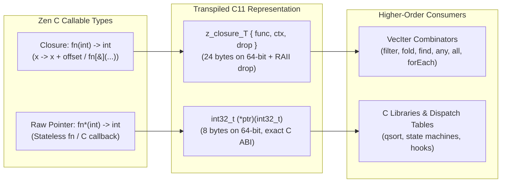

# 第 14 章：函数式特性：闭包与迭代器

函数式编程——将函数作为值传递、在匿名闭包中捕获词法状态，以及通过声明式迭代器管道转换数据序列——通常与垃圾回收型语言联系在一起。从历史上看，编写 C 语言的系统程序员不得不在富有表现力的高阶抽象与底层硬件的可预测性之间做出抉择。

Zen C 通过提供**三种不同的可调用与可迭代抽象**弥合了这一鸿沟，每种抽象都具有透明、可预测的 C11 编译模型：

1. **Lambda 与闭包（`fn(Args) -> Ret`）**：可以从其外层作用域中**按值**（默认 / `[=]`）或**按引用**（`[&]`）捕获变量的匿名函数，在运行时表示为胖闭包结构体（`z_closure_T { void* func; void* ctx; void (*drop)(void*); }`），并带有自动的 RAII 上下文清理。
2. **原始函数指针（`fn*(Args) -> Ret`）**：零开销、无状态的 C 函数指针（`Ret (*)(Args)`），不需要上下文分配，可以直接跨 C ABI 传递给系统 API，如 `qsort`、`signal` 或事件循环回调。
3. **迭代器（`Iterator<T>` 与 `VecIter<T>`）**：驱动 `for item in collection` 循环（通过静态编译期单态化）以及诸如 `.filter(...)`、`.fold(...)`、`.find(...)`、`.any(...)` 和 `.all(...)` 等函数式组合器的有状态游标结构体。

---

## 在 `fn(...)` 闭包与 `fn*(...)` 指针之间做出选择

| 特性 | 闭包（`fn(T) -> R`） | 原始函数指针（`fn*(T) -> R`） |
| :--- | :--- | :--- |
| **能否捕获局部变量？** | **能**（`[=]` 按值，`[&]` 按引用） | **否**（仅限无状态的顶层 `fn`） |
| **C11 表示** | `z_closure_T { func, ctx, drop }`（24 字节） | `R (*)(T)`（64 位上 8 字节） |
| **堆分配** | 捕获状态时分配上下文结构体；通过 `.drop` 自动释放 | **零**堆分配 |
| **C FFI 兼容性** | Zen C 高阶函数与 `VecIter<T>` | **100% C ABI 兼容**（`qsort`、`pthread`、C 结构体） |

---

## 本章路线图

在本章中，我们将探索 Zen C 的函数式工具及其底层的 C11 代码生成：

1. **[14.1 Lambda 与闭包捕获](ch14-01-lambdas.md)**：使用简洁的箭头语法（`x -> expr`）和显式块语法（`fn(x: int) -> int { ... }`）编写匿名函数，按值（`[=]`）与按引用（`[&]`）捕获环境状态，并编写接收 `fn(...)` 闭包的高阶函数。
2. **[14.2 原始函数指针（`fn*`）](ch14-02-fn-pointers.md)**：声明、返回和存储无状态 C 函数指针（`fn*`）与指向函数指针的指针（`fn**`），构建结构体分派表，并将 Zen C 比较器直接传递给 C 的 `qsort`。
3. **[14.3 使用迭代器处理元素](ch14-03-iterators.md)**：理解 Zen C 的 `iterator()` / `next()` 协议，链式调用 `VecIter<T>` 组合器（`filter`、`fold`、`find`、`any`、`all`、`forEach`），在按值（`VecIter<T>`）和按引用（`VecIterRef<T>`）迭代之间进行选择，并实现自定义迭代器结构体。
4. **[14.4 性能对比：循环 vs 迭代器](ch14-04-performance.md)**：检查为索引循环、`for ... in` 迭代器和闭包组合器发射的精确 C11 循环，并理解后端 C 编译器优化器（`-O2` / `-O3`）如何对它们进行内联和自动向量化。
