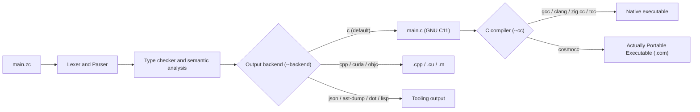

# zc 工具链与编译器后端

到目前为止，前面的每一章都将 `zc run` 或 `zc build` 视作一个黑盒：你交给它一个 `.zc` 文件，就能得到一个运行中的程序。在本章中，我们将打开这个黑盒。

Zen C 是一个**转译器（transpiler）**。`zc` 解析并对你的 Zen C 源码进行类型检查，然后发射出易读的 GNU C11 文件，并将该文件交给普通的 C 编译器——`gcc`、`clang`、`zig cc`、`tcc` 或 Cosmopolitan 的 `cosmocc`。了解该流水线的工作原理有助于你：

- 选择并配置用于构建程序的 C 编译器，
- 在调试、性能分析或与 C 代码链接时阅读生成的 C 代码，
- 发布一个能在 Linux、macOS、Windows 和各 BSD 系统上运行的单一二进制文件，
- 在日常开发中使用格式化器、文档生成器、REPL 和语言服务器。

---

## 编译流水线

这里有两个独立的控制维度：

| 控制项 | 标志 | 选择内容 | 默认值 |
| :--- | :--- | :--- | :--- |
| **输出后端** | `--backend <name>` | `zc` 生成*什么*（C、C++、CUDA、Objective-C、JSON AST 等） | `c` |
| **C 编译器** | `--cc <compiler>` | *哪个程序*将生成的代码编译为机器码 | `gcc` |

---

## `zc` 命令速览

| 命令 | 作用 |
| :--- | :--- |
| `zc run main.zc [args]` | 转译、编译并立即运行（文件名后的参数将传递给你的程序）。 |
| `zc build main.zc -o app` | 转译并编译为可执行文件（或使用 `-shared` 编译为共享库）。 |
| `zc check main.zc` | 仅进行解析和类型检查——不生成 C 代码。为编辑器和 CI 提供快速反馈。 |
| `zc transpile main.zc -o main.c` | 发射生成的 C 文件后停止。 |
| `zc-format`, `zc-doc`, `zc-repl`, `zc-lsp` | 格式化器、文档生成器、交互式 REPL 和语言服务器。 |

---

## 本章路线图

1. **[15.1 配置编译器后端](ch15-01-compiler-backends.md)**：使用 `--cc` 切换 C 编译器、优化与调试标志、`-D` 宏，以及将链接标志保留在代码旁的 `//>` 构建指令。
2. **[15.2 检查生成的 C 代码与名称修饰](ch15-02-generated-c.md)**：阅读 `zc transpile` 的输出、理解结构体、方法、trait 和泛型如何映射到 C 符号，以及从 C 中调用 Zen C。
3. **[15.3 真正可移植的可执行文件（APE）](ch15-03-portable-ape.md)**：使用 Cosmopolitan Libc 构建能在六种操作系统上原生运行的单一二进制文件。
4. **[15.4 开发者工具：zc-doc、zc-format、REPL 与 LSP](ch15-04-developer-tooling.md)**：生成 API 文档、强制代码格式化、进行交互式实验，以及配置你的编辑器。
