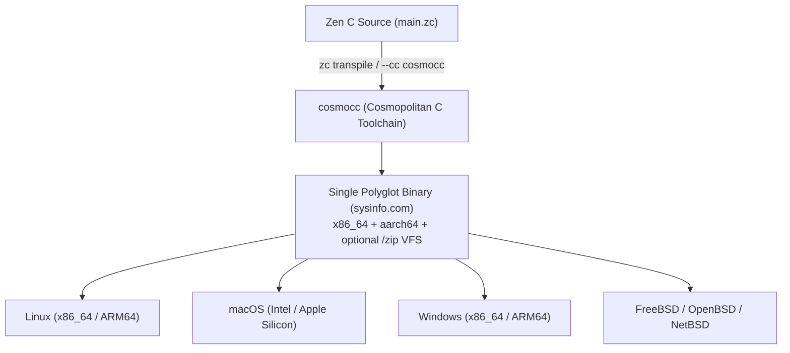

# 真正可移植的可执行文件（APE）

如果你能在 Linux 上编译一个 Zen C 程序**一次**，然后将生成的二进制文件分发给使用 macOS、Windows、FreeBSD、OpenBSD 和 NetBSD 的同事——横跨 `x86_64` 和 `aarch64`（Apple Silicon / ARM64）两种架构——且无需任何虚拟机、容器或运行时依赖，这该有多好？

因为 Zen C 直接转译为标准 C11，所以你可以将 `zc` 与 **[Cosmopolitan Libc](https://github.com/jart/cosmopolitan)**（`cosmocc`）配合使用，生成**真正可移植的可执行文件（Actually Portable Executables，`.com`）**。更棒的是，Zen C 编译器自身（`zc.com`）也可以构建为一个 APE 二进制文件，并将整个 Zen C 标准库嵌入在其内部作为 `/zip` 虚拟文件系统。

---

## 1. 真正可移植的可执行文件如何工作

真正可移植的可执行文件（`.com`）是由 Justine Tunney 的 Cosmopolitan 项目设计的混合格式（polyglot）二进制文件头，它同时编码了：
- 有效的 **Windows PE/COFF** 可执行文件头，
- 有效的 **POSIX shell 脚本**头，负责映射并引导嵌入的 **Linux / BSD / macOS ELF / Mach-O** 段，
- 针对 **`x86_64`** 和 **`aarch64`** 的胖多架构机器码，以及
- 位于文件末尾的可选 **PKZIP 归档**，在运行时可通过 `/zip/...` 路径访问。



---

## 2. 安装 `cosmocc`

要构建 APE 二进制文件，请从 Cosmopolitan 的 GitHub Releases 下载 `cosmocc` 工具链（匹配 Zen C CI 中锁定的版本），并将其 `bin/` 目录添加到你的 `PATH` 中：

```bash
mkdir -p ~/cosmocc
cd ~/cosmocc
curl -LO https://github.com/jart/cosmopolitan/releases/download/4.0.2/cosmocc-4.0.2.zip
unzip cosmocc-4.0.2.zip
export PATH="$HOME/cosmocc/bin:$PATH"
```

> **注意：** 上游滚动镜像（`https://cosmo.zip/pub/cosmocc/cosmocc.zip`）经常无法访问，因此建议直接从 [`jart/cosmopolitan` GitHub Releases](https://github.com/jart/cosmopolitan/releases) 下载锁定的版本归档。

`export` 仅影响当前终端。要使 `cosmocc` 在每个新 shell 中都可用，请将其添加到你的 shell 配置文件中：

```bash
echo 'export PATH="$HOME/cosmocc/bin:$PATH"' >> ~/.bashrc
```

验证 `cosmocc` 是否可用：

```console
$ cosmocc --version
```

---

## 3. 将 Zen C 程序编译为 APE 二进制文件

一旦 `cosmocc` 进入你的 `PATH`，即可向 `zc build` 传递 `--cc cosmocc`（或者先用 `zc transpile` 转译，再直接调用 `cosmocc`）。

代码清单 15-3 使用 POSIX `uname(2)`（Cosmopolitan 在所有六种操作系统上都实现了该函数，包括 Windows），并在编译期检查 `__COSMOPOLITAN__` 宏，以报告该二进制文件是如何构建的以及它当前运行在哪个操作系统/架构上：

**代码清单 15-3: 同时兼容原生与 APE 构建的跨平台系统报告程序**

```zenc
// File: examples/ch15/ch15-03-portable-ape/main.zc
//
// Native build:   zc build examples/ch15/ch15-03-portable-ape/main.zc -o sysinfo
// Portable build: zc build examples/ch15/ch15-03-portable-ape/main.zc --cc cosmocc -o sysinfo.com
//
// The same source works for both. With cosmocc, the resulting `sysinfo.com`
// runs unmodified on Linux, macOS, Windows, and the BSDs (x86_64 and aarch64).

include <sys/utsname.h>

raw {
    // Report *how* this binary was built (decided at compile time).
    static const char *build_kind(void) {
        #if defined(__COSMOPOLITAN__)
        return "Actually Portable Executable (cosmocc)";
        #else
        return "native executable";
        #endif
    }

    // Report *where* this binary is running (decided at run time).
    // uname(2) is provided by both the host libc and Cosmopolitan Libc.
    static const char *running_os(void) {
        static struct utsname info;
        if (uname(&info) != 0) return "unknown";
        return info.sysname;
    }

    static const char *running_arch(void) {
        static struct utsname info;
        if (uname(&info) != 0) return "unknown";
        return info.machine;
    }
}

extern fn build_kind() -> const char*;
extern fn running_os() -> const char*;
extern fn running_arch() -> const char*;

fn main() {
    println "Build kind : {build_kind()}";
    println "Running on : {running_os()} ({running_arch()})";
    println "Hello from one binary, many operating systems!";
}
```

### 原生构建（`gcc` / `clang`）

当使用 `zc run` 或 `zc build` 正常编译时，`__COSMOPOLITAN__` 未被定义，程序将链接宿主操作系统的 C 库：

```console
$ zc run -q examples/ch15/ch15-03-portable-ape/main.zc
Build kind : native executable
Running on : Linux (x86_64)
Hello from one binary, many operating systems!
```

### 可移植 APE 构建（`--cc cosmocc`）

当使用 `--cc cosmocc` 构建时，`cosmocc` 会定义 `__COSMOPOLITAN__` 并将 Cosmopolitan 的多操作系统胖运行时链接进 `sysinfo.com`：

```bash
zc build examples/ch15/ch15-03-portable-ape/main.zc --cc cosmocc -o sysinfo.com
```

现在你可以将 `sysinfo.com` 复制到 Linux、macOS、Windows（其中 `.com` 扩展名在 `cmd.exe` 和 PowerShell 中原生可执行）或 FreeBSD 上直接运行：

```text
Build kind : Actually Portable Executable (cosmocc)
Running on : Linux (x86_64)
Hello from one binary, many operating systems!
```

> [!NOTE]
> 当 `cosmocc` 编译 `sysinfo.com` 时，它还会生成伴随的中间文件（包含 DWARF 调试符号的 `sysinfo.com.dbg` 以及针对 ARM64 切片的 `sysinfo.aarch64.elf`），然后将它们合并到 `sysinfo.com` 中。分发时只需要 `sysinfo.com` 即可。

---

## 4. 将 Zen C 编译器自身构建为 APE（`zc.com`）

不仅你的 Zen C 程序可以编译为 APE 二进制文件——**Zen C 编译器（`zc`）本身**在其仓库 Makefile 中也拥有一等公民级别的 APE 支持：

```bash
# Inside the Zen-C compiler repository:
export PATH="$HOME/cosmocc/bin:$PATH"
make ape ZC_HAS_JIT=0
sudo env "PATH=$PATH" make install-ape ZC_HAS_JIT=0
```

运行 `make ape` 会在 `out/bin/` 中构建两个自包含的产物：

| 产物 | 说明 |
| :--- | :--- |
| **`out/bin/zc.com`** | 可移植的 Zen C 编译器。所有编译器插件均静态链接，并且整个 `std/` 标准库、`std.zc` 以及编译器元数据（`zenc.json`、`facts.json`、`docs.json`）都直接打包在可执行文件的 `/zip/` 虚拟文件系统内部。 |
| **`out/bin/zc-boot.com`** | 自包含的引导程序，可解压出一个初始项目（`hello.zc` 和一个 `Makefile`），并在任何受支持的操作系统上开箱即用运行 `zc.com`。 |

因为 `zc.com` 将 `std/` 嵌入在 `/zip/std` 内部，所以你可以将单独的 `zc.com` 文件复制到任何带有 C 编译器（或 `cosmocc`）的机器上，无需设置 `ZC_ROOT` 或安装 `/usr/local/share/zenc` 即可编译 Zen C 程序：

```bash
./out/bin/zc.com build hello.zc -o hello
```

---

## 小结

- 使用 Cosmopolitan 的 `cosmocc` 构建的**真正可移植的可执行文件（`.com`）**可在 Linux、macOS、Windows、FreeBSD、OpenBSD 和 NetBSD 上的 `x86_64` 和 `aarch64` 架构上原生运行。
- 使用 `zc build app.zc --cc cosmocc -o app.com` 将任何 Zen C 程序构建为 APE 二进制文件，并在 `raw` C 块中通过 `#ifdef __COSMOPOLITAN__` 检测 APE 构建。
- 使用 `make ape` 将 Zen C 编译器自身构建为单文件可移植工具链（`out/bin/zc.com`）。
